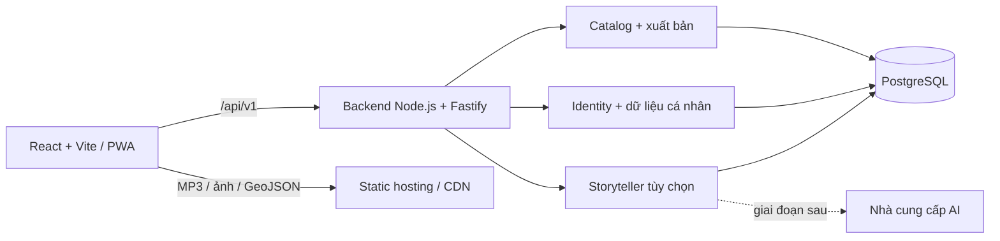
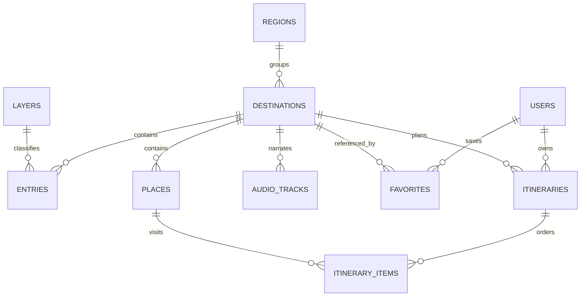

# Thiết kế backend Bản đồ Tri thức

Trạng thái: đề xuất ban đầu, ngày 21/10/2026. Tài liệu mô tả thiết kế để triển khai; repo chưa có server, database, migration hay cơ chế đăng nhập.

Bổ sung ưu tiên demo: QR vào app và dashboard online dùng Supabase Realtime Presence, xem [DEMO-REALTIME.md](../DEMO-REALTIME.md). Phần này hoạt động độc lập với backend catalog/cá nhân đề xuất bên dưới; cần cấu hình dịch vụ trước khi có số đếm thật.

## 1. Mục tiêu và phạm vi

Backend cung cấp nội dung du lịch có nguồn, quản lý phiên bản nội dung và đồng bộ bộ sưu tập/lịch trình giữa các thiết bị. Người dùng vẫn khám phá, nghe kể chuyện và lập lịch trình khi chưa đăng nhập.

Giả định cho MVP: tập trung Việt Nam, lịch trình chỉ thuộc một điểm đến, dữ liệu do nhóm biên tập quản lý, một nhóm phát triển nhỏ. Chưa đưa thanh toán, đặt dịch vụ, đánh giá công khai hoặc cộng tác thời gian thực vào phạm vi.

### Hiện trạng đã đối chiếu với mã nguồn

| Thành phần | Hiện tại | Hướng chuyển đổi |
| --- | --- | --- |
| `src/data/content.js` | 3 điểm đến (`ha-noi`, `hue`, `tp-hcm`), 36 bài tri thức, 28 địa điểm tham quan; 6 lớp, 4 ngôn ngữ | Nguồn seed chính, giữ nguyên ID và thứ tự |
| `public/data/data.json` | Bộ dữ liệu mẫu có cấu trúc/lớp khác; không thấy frontend sử dụng | Không tự động trộn vào seed |
| `src/data/knowledgeRelations.js` | 9 thẻ nội dung liên quan, ID chưa nối trực tiếp tới bài tri thức | Lưu thành thẻ riêng; chỉ gắn entry/place khi đã có mapping được kiểm tra |
| `src/data/storyScripts.js`, `src/lib/story.js` | Dựng lời kể `short/full` từ nội dung có sẵn | Giữ xử lý tại client ở MVP; đưa kịch bản vào gói nội dung |
| `public/audio/manifest.json` | 18 track, ngôn ngữ `vi/en/zh`; chưa có `ko` | Quản lý metadata/version; file phát qua static hosting/CDN |
| `useCollection`, `useItineraries` | `bdtt.collection.v2`, `bdtt.itineraries.v1` trong localStorage | Giữ chế độ khách; bổ sung nhập và đồng bộ sau đăng nhập |
| `src/lib/storyteller.js` | Có điểm nối `VITE_STORYTELLER_API`; gửi nội dung từ client | Backend chỉ tin ID, tự đọc nội dung đã xuất bản |
| `public/sw.js` | Cache app shell và audio; chưa có luồng cache dữ liệu API | Bổ sung cache nội dung công khai theo version; loại API cá nhân khỏi cache |

`history/heritage/culture/food/tourism/story` là lớp tri thức. `heritage/culture/food/fun` là loại địa điểm (`kind`), không dùng chung một enum.

## 2. Kiến trúc đề xuất

Một ứng dụng backend chia mô-đun, một PostgreSQL, file media ở static hosting hoặc object storage. Chưa cần microservices, Redis, graph database hoặc hàng đợi riêng.



| Quyết định | Lý do trong dự án này |
| --- | --- |
| Node.js 24 LTS + TypeScript cho server | Cùng hệ sinh thái JS với frontend; type cho dữ liệu và API. Chốt patch version khi khởi tạo |
| Fastify với JSON Schema request/response | Dùng hợp đồng API để kiểm tra đầu vào và giới hạn trường trả về |
| PostgreSQL; SQL migration đánh số, driver `pg` | Quan hệ nội dung, owner và lịch trình cần khóa ngoại/transaction; SQL dễ kiểm tra |
| REST `/api/v1` | Phù hợp các thao tác đọc nội dung và CRUD cá nhân hiện có |
| Một origin cho frontend và API khi triển khai | Đơn giản cookie, CORS và cấu hình PWA; proxy `/api` trong Vite khi phát triển |
| OIDC cho đăng nhập ở giai đoạn 2 | Tránh tự xây kho mật khẩu; nhà cung cấp cụ thể quyết định trước khi triển khai auth |

Fastify hỗ trợ kiểm tra/serialize bằng JSON Schema theo [tài liệu chính thức](https://fastify.dev/docs/latest/Reference/Validation-and-Serialization/). Dùng khóa ngoại, unique và check theo [PostgreSQL Constraints](https://www.postgresql.org/docs/current/ddl-constraints.html). Chọn runtime LTS theo [Node.js Releases](https://nodejs.org/en/about/previous-releases).

### Ranh giới mô-đun

- **Catalog:** điểm đến, lớp tri thức, bài viết, địa điểm, bản dịch, nguồn tham khảo, thẻ liên quan. Chỉ trả nội dung đã xuất bản cho API công khai.
- **Identity:** ánh xạ danh tính OIDC, phiên đăng nhập và vai trò `member/editor/admin`.
- **Personal:** bộ sưu tập, lịch trình, nhập dữ liệu khách và kiểm tra quyền sở hữu.
- **Narration:** kịch bản, metadata audio; storyteller AI là tính năng tùy chọn tách biệt với bộ dựng `short/full`.
- **Operations:** health/readiness, log request, cấu hình, migration/seed và backup.

Mỗi mô-đun theo luồng route → service → repository. Route không gọi SQL trực tiếp; transaction thuộc service. Không chia sẻ hàm React, hook hoặc `import.meta.env` sang server. Thuật toán thuần ở `src/lib/itinerary.js` có thể tách sang package dùng chung khi cần API gợi ý.

## 3. Mô hình dữ liệu

ID nội dung giữ dạng chuỗi hiện có để bảo toàn QR `?story=ha-noi`, bộ sưu tập và tham chiếu trong lịch trình. User, session và itinerary mới dùng UUID do server tạo. Timestamp trong DB là `timestamptz`, API dùng ISO 8601 UTC. Adapter frontend chuyển về milliseconds cho `createdAt` hiện tại nếu cần.

| Bảng | Trường và ràng buộc chính |
| --- | --- |
| `regions` / `region_translations` | `id` (`north/central/south`), color; PK bản dịch `(region_id, lang)`, name |
| `layers` / `layer_translations` | `id`, icon, color, position; bản dịch name, description |
| `destinations` | `id`, `region_id` FK, latitude [-90,90], longitude [-180,180], hero JSONB (từ khóa ảnh), suggested_days, days_min/max, best_months JSONB, status, version, published_at, deleted_at |
| `destination_translations` | PK `(destination_id, lang)`; name, tagline, intro, best_note |
| `entries` / `entry_translations` | `id`, `destination_id` FK, `layer_id` FK, position, wiki JSONB; bản dịch title, body |
| `places` / `place_translations` | `id`, `destination_id` FK, kind, duration_minutes > 0, slot, zone, must_visit, position, deleted_at; bản dịch name, note |
| `sources` | UUID, label, URL HTTPS |
| `destination_sources` / `entry_sources` | Khóa ghép liên kết nội dung và nguồn; nguồn cấp điểm đến hiện có được giữ nguyên, không suy diễn thành nguồn cấp bài |
| `related_cards` / `related_card_translations` | PK `(destination_id, id)`, icon, position, optional target_entry_id/target_place_id FK; bản dịch type_label, title, note |
| `story_scripts` | PK `(destination_id, lang)`, open_text, close_text |
| `story_connectors` | PK `(layer_id, lang)`, text, short_sentence_limit |
| `audio_tracks` | UUID, destination_id, lang, mode (`short/full`), content_version, URL, checksum, optional duration_ms; unique `(destination_id, lang, mode, content_version)` |
| `users` | UUID, unique `(oidc_issuer, oidc_subject)`, display_name, preferred_lang, role, created_at |
| `sessions` | UUID, user_id FK, token_hash unique, expires_at, created_at; chỉ lưu hash token ngẫu nhiên |
| `favorites` | PK `(user_id, destination_id)`, created_at; FK tới user và destination |
| `itineraries` | UUID, user_id FK, destination_id FK, name, month [1,12], days [1,7], people [1,30], interests JSONB, notes, rating [0,5], version >= 1, created_at, updated_at, deleted_at |
| `itinerary_items` | itinerary_id, destination_id, place_id, day_index, position; unique `(itinerary_id, place_id)` và `(itinerary_id, day_index, position)` |
| `imported_itineraries` | PK `(user_id, installation_id, legacy_id)` → itinerary_id; bảo đảm retry nhập không tạo bản sao |
| `audit_events` | UUID, actor_id, action, entity_type/id, occurred_at; không ghi token hoặc toàn bộ ghi chú cá nhân |

Các bảng bản dịch có `lang` giới hạn `vi/en/zh/ko`, FK tới bảng gốc. Bản dịch tiếng Việt là điều kiện xuất bản. API giai đoạn đầu trả các map đa ngôn ngữ tương thích `pick()`; không thay map bằng chuỗi theo locale. UI text trong `src/i18n.js` vẫn là tài nguyên frontend.



### Ràng buộc và index khi viết migration

- `coords` của frontend theo `[latitude, longitude]`; không nhầm với thứ tự GeoJSON `[longitude, latitude]`. Chưa cần PostGIS vì dữ liệu hiện tại không có tọa độ từng place.
- `best_months` phải là mảng đúng 12 số nguyên 1–3; `days_min <= suggested_days <= days_max`. Schema API và validator xuất bản kiểm tra trước khi ghi; SQL kiểm tra điều kiện trong từng hàng phù hợp.
- `hours` frontend chuyển thành `duration_minutes = round(hours * 60)`; serializer chuyển ngược để giữ DTO cũ.
- `kind` chỉ nhận `heritage/culture/food/fun`; slot chỉ `morning/afternoon/evening`. `zone` là số khu vực phục vụ sắp xếp, không phải tọa độ.
- `plan` là mảng đủ `days` mảng con, ít nhất một place toàn hành trình; ngày rỗng hợp lệ. Không lặp place; `day_index` zero-based trong [0, days-1]. Giới hạn ngày là kiểm tra xuyên bảng nên service kiểm tra trong transaction, không dùng CHECK đọc bảng khác.
- Dùng unique `(id, destination_id)` trên places và itineraries. `itinerary_items` có composite FK tới cả hai để không thể ghép place khác điểm đến. Thay header và toàn bộ items trong cùng transaction; khóa/CAS version header trước khi thay items.
- Nội dung đã được lịch trình tham chiếu chỉ được archive; không hard delete. Item cũ vẫn trả về với cờ unavailable, thêm item mới vào place đã archive trả 422. Xóa user có thể cascade dữ liệu cá nhân.
- Index: entries `(destination_id, layer_id, position)`; places `(destination_id, position)`; itineraries `(user_id, updated_at DESC, id)` với điều kiện chưa xóa; session `expires_at`. Khóa ghép favorites phục vụ đọc theo user; thêm index FK còn thiếu theo truy vấn thực tế.
- Tìm kiếm MVP trên name/title/body của các bản dịch đã xuất bản: normalize Unicode, chữ thường và bỏ dấu tiếng Việt (bao gồm `đ → d`). Ban đầu scan tập nhỏ; khi đo được nhu cầu mới thêm search index. Không nhận SQL hoặc biểu thức regex tùy ý từ client.

## 4. Nội dung, audio và offline

Một lần xuất bản tăng `contentVersion` toàn catalog trong cùng transaction với nội dung. `version` điểm đến tăng khi aggregate của nó thay đổi (bài, place, bản dịch, nguồn, script). Response bootstrap được dựng từ một snapshot nhất quán. API công khai không trả draft/archived.

MVP chỉ biên tập bằng seed/import đã kiểm tra, chưa cần dashboard admin. Sau này editor tạo draft; thao tác publish kiểm tra ID, bản dịch bắt buộc, nguồn, quan hệ và ghi audit. Draft của dữ liệu đang live cần bảng revision riêng trước khi mở CMS, tránh ghi đè trực tiếp bản đang xuất bản.

Giữ `/audio/manifest.json` và URL MP3 hiện có trong giai đoạn chuyển đổi. Khi sửa lời kể, tạo URL audio có version/hash mới; không ghi đè URL đã được tải offline. Track mới chỉ công bố sau khi upload và checksum thành công; chưa có track đúng version thì dùng TTS trên thiết bị, không ghép audio cũ với transcript mới. Audio import ban đầu đánh dấu version đã được nhóm kiểm tra, không tự giả định MP3 khớp script.

Frontend lưu gói bootstrap công khai gần nhất trong IndexedDB, kiểm tra ETag khi online. Chỉ thay snapshot local sau khi tải/validate thành công; lỗi mạng giữ snapshot trước và thể hiện đang dùng bản đã tải. Offline lần đầu dùng fixture đi kèm build trong thời gian chuyển đổi. `?story=` tiếp tục hoạt động.

Khi thêm API, service worker phải bypass `/api/v1/auth`, `/api/v1/me`, `/api/v1/itineraries` và `/api/v1/storyteller`; response cá nhân luôn `Cache-Control: no-store`. Không dùng cache chung theo URL cho dữ liệu tài khoản. Khi logout, xóa cache/outbox cá nhân của user, giữ các gói nội dung công khai và dữ liệu khách riêng.

## 5. Đăng nhập, phân quyền và đồng bộ

Giai đoạn 2 dùng OIDC Authorization Code + PKCE do backend điều phối; kiểm tra state, nonce, issuer, audience và callback URL cố định. Backend tạo session cookie `HttpOnly`, `Secure` ở production, `SameSite=Lax`, `Path=/`; phiên hết hạn sau tối đa 7 ngày, rotate khi đăng nhập, thu hồi khi logout. Token nhà cung cấp không trả về JavaScript.

API cá nhân suy user từ session. Client không được gán `userId`, role hoặc server timestamps. Mọi truy vấn itinerary gồm điều kiện owner; đọc/sửa/xóa ID của người khác trả 404. Cookie-auth mutation kiểm tra Origin đúng allowlist và CSRF token gắn với phiên. CORS chỉ bật origin dev được cấu hình, không dùng wildcard với credentials. Luồng auth chưa triển khai cho đến khi chọn nhà cung cấp và cấu hình callback/secrets.

### Nhập dữ liệu localStorage hiện có

1. Tách namespace dữ liệu khách và từng user; frontend tạo `installationId` ngẫu nhiên bền vững. Không dùng IP làm định danh.
2. Sau đăng nhập, người dùng chủ động chọn nhập dữ liệu khách. Gửi favorites và itinerary cũ trong một request giới hạn; giữ bản local đến khi server xác nhận.
3. Server validate toàn bộ trước, rồi ghi transaction: union favorites, tạo itinerary mới với UUID, lưu mapping `(user, installationId, legacyId)`. Retry chỉ trả mapping cũ, không ghi đè itinerary đã chỉnh trên server. Hai thiết bị dùng hai installationId có thể nhập thành hai bản riêng.
4. `createdAt` cũ nếu cần giữ thì lưu metadata `legacyCreatedAt`; timestamp chính do server cấp. ID lỗi/unknown được trả theo đường dẫn trường và chặn toàn batch; frontend cho chỉnh/bỏ mục lỗi rồi gửi lại. Không âm thầm bỏ mất địa điểm.
5. Chỉ đánh dấu đã nhập sau phản hồi thành công. Không xóa localStorage gốc tự động trong lần chuyển đổi đầu.

### Chỉnh sửa đồng thời và offline

GET itinerary trả strong ETag `"itinerary-<id>-v<version>"`. PATCH/DELETE phải có `If-Match`; thiếu trả 428, version cũ trả 412 kèm version hiện tại. Transaction dùng `UPDATE ... WHERE id AND user_id AND version`; tăng version đúng một lần khi thay đổi. Không lấy thời gian thiết bị làm quy tắc ghi đè.

MVP đồng bộ cá nhân chỉ ghi khi online; edit offline tạo bản nháp cục bộ, chưa báo đã đồng bộ. Khi có mạng, gửi với base version; gặp 412 thì giữ nháp và cho so sánh/tạo bản sao, không tự overwrite. Favorites dùng PUT/DELETE idempotent, server không có endpoint toggle. Xóa itinerary dùng tombstone và tăng version; danh sách full refresh không trả tombstone. Sync incremental/outbox tự động là giai đoạn sau, khi có cursor và chính sách lưu tombstone rõ ràng.

## 6. API và an toàn vận hành

Hợp đồng chi tiết, DTO và lỗi nằm ở [api.md](api.md). Fastify phải validate cả params/query/body, giới hạn body mặc định 256 KiB và từ chối trường lạ trên mutation. Giới hạn MVP: name 160 ký tự, notes 5.000, query 100; import tối đa 100 itinerary và 500 favorites mỗi batch. Văn bản là plain text, không HTML tùy ý. SQL luôn có parameters.

Storyteller chỉ dùng nội dung server đã xuất bản; không fetch URL từ payload. Prompt phía server, khóa AI chỉ ở biến môi trường backend. Cache nếu có theo `(destId, lang, mode, contentVersion, promptVersion)`; giới hạn thời gian và chi phí. API nội dung công khai vẫn hoạt động khi AI lỗi. Endpoint AI chỉ bật khi đã có auth/quota; chưa bật trong giai đoạn 1. Rate limit ban đầu cấu hình theo nhóm endpoint, `Retry-After` khi 429; nhiều replica cần bộ đếm dùng chung trước khi mở AI.

Log có requestId, route, status, latency; che cookie, authorization, token và nội dung ghi chú. `/health/live` chỉ báo process; `/health/ready` kiểm tra DB với timeout và schema migration tương thích. Production kết thúc TLS ở reverse proxy, cấu hình trusted proxy cụ thể; giới hạn pool DB và timeout truy vấn.

Triển khai đầu tiên: một process API, PostgreSQL riêng, frontend/static hosting; assets vẫn dùng host hiện có. Migration chạy một job riêng trước deploy; seed không tự chạy lúc server khởi động. Backup hằng ngày, mục tiêu ban đầu RPO 24 giờ/RTO 4 giờ (cần xác nhận với yêu cầu vận hành); phải thử restore trước khi lưu dữ liệu cá nhân thật. Không chốt nhà cung cấp hosting khi chưa có ngân sách hoặc hạ tầng yêu cầu.

## 7. Cấu trúc thư mục dự kiến

```text
server/
  package.json                 # dependency/script riêng, lockfile riêng
  src/
    app.ts                     # tạo app để test không cần listen
    main.ts                    # load config, listen, graceful shutdown
    config.ts
    plugins/                   # db, session, errors, request-id
    modules/
      catalog/                 # routes, schemas, service, repository
      identity/
      personal/
      narration/
    db/
      migrations/
      seed/
  test/                        # integration + contract, database riêng
docs/backend/
  README.md
  api.md
```

Đây là cấu trúc dự kiến, chưa phải các file đã được tạo. Backend có tsconfig/lint riêng; config ESLint hiện tại mặc định browser nên cần scope trước khi thêm code server.

## 8. Thứ tự triển khai và tiêu chí hoàn thành

| Giai đoạn | Công việc | Điều kiện hoàn thành |
| --- | --- | --- |
| 1 — Catalog đọc | Khởi tạo server, DB migration/seed, health, bootstrap, list/detail/search; tạo OpenAPI từ route schema | Seed retry không nhân đôi; kiểm tra đủ 3 destination/36 entry/28 place/6 layer/18 metadata track; API không lộ draft; build frontend vẫn chạy |
| 1b — Nối frontend | Adapter bootstrap giữ DTO, thay import nội dung từng bước; snapshot offline và kiểm tra QR/audio | Đổi ngôn ngữ, mở `?story=hue`, tìm kiếm, lập lịch trình, fallback offline; nội dung fixture và API tương đương |
| 2 — Dữ liệu cá nhân | Chọn OIDC provider, session, favorites, itinerary CRUD, nhập local và version conflict | Hai user không đọc/sửa được dữ liệu nhau; import retry an toàn; PATCH cũ trả 412; transaction không để plan dở dang; logout không lộ dữ liệu account trước |
| 3 — Biên tập/media/AI | Revision xuất bản, audit, audio version và storyteller có quota | Không công bố draft hoặc audio chưa hoàn tất; AI lỗi vẫn dùng local; thử restore backup thành công |

Bộ kiểm thử backend tập trung vào ranh giới có rủi ro: seed và khóa ngoại, payload sai, owner isolation, concurrent update, idempotent import, tương thích DTO, ETag/public cache và lỗi DB/provider. Chạy integration trên PostgreSQL thật trong môi trường test; không suy tính đúng của transaction từ mock repository.

Bước triển khai tiếp theo đã xác định: dựng giai đoạn 1. Auth provider, hosting và chính sách lưu dữ liệu cá nhân chỉ cần quyết định trước giai đoạn 2/deploy, không cản trở API nội dung.
